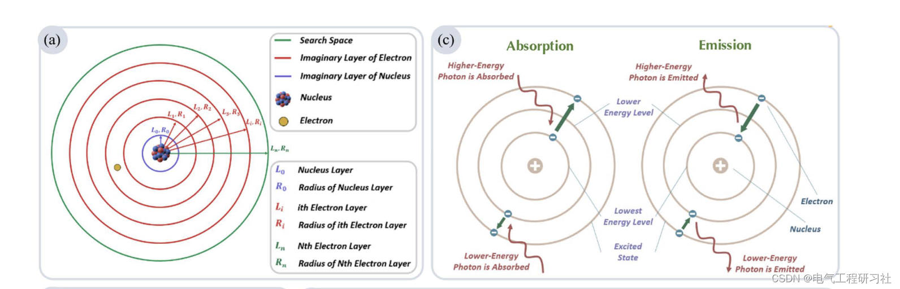
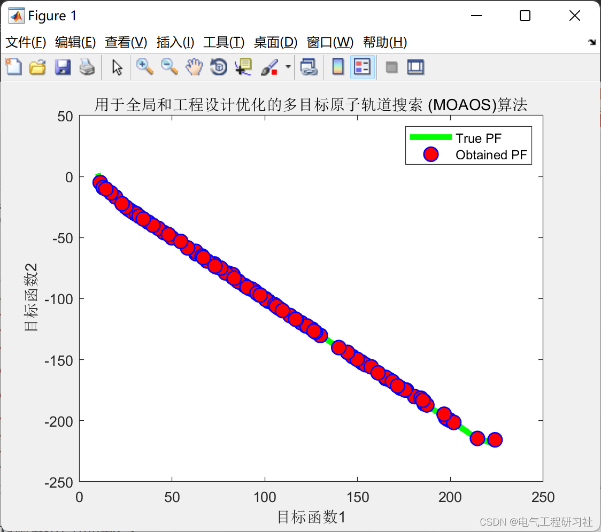

# Multi-Objective Optimization Algorithm | Multi-Objective Atomic Orbit Search (MOAOS) Algorithm for Global and Engineering Design Optimization (Matlab Code Implementation)

1. Overview One of the primary capabilities of the human brain is the ability to identify "best" choices and implement them accordingly. However, we also recognize that in many cases, identifying all the conditions that lead to the best solution is extremely difficult or impossible. Therefore, in many cases, it is practical and effective to use a "sufficiently satisfactory" solution instead of the "globally optimal" solution for solving the problem. Optimization aims to improve the overall performance of the system to achieve one (or more) points where the system's behavior is optimal.
In the real world, many optimization problems are so uncertain and complex that a single objective function cannot represent all the characteristics of the considered system. Therefore, multi-objective optimization algorithms are needed to consider multiple aspects of the problem, represented by multiple objective functions, in order to obtain reasonable and useful results through the optimization process. In this paper, the recently developed single-objective metaheuristic algorithm is introduced as its multi-objective version, called Atomic Orbit Search (AOS), also known as Multi-Objective Atomic Orbit Search (MOAOS). To this end, general aspects and the main search loop of the AOS algorithm have been modified to enable it to handle multi-objective problems.For the performance evaluation of this algorithm, mathematical benchmark problems ZDT and DTLZ, as well as several real-world engineering design problems and CEC-2020 MMO test problems were used. Based on the results obtained in this study, it can be concluded that MOAOS is capable of producing better or comparable results when competing with alternative state-of-the-art metaheuristic methods. The structure of this paper is as follows. Section 2 introduces the mathematical model of the proposed multi-objective AOS optimization algorithm (MOAOS).
Part three describes the results and discussions of the study, including performance metrics, experimental setups, discussions on ZDT and DTLZ testing functions, as well as a set of different engineering design problems, including four-bar truss, welded beam, disc brake, and gearbox design issues, along with CEC-2020 MMO testing questions [53]. Finally, section four summarizes the entire paper.
2 The mathematical model calculates the objective function value for each candidate solution, representing the energy levels of electrons around an atomic nucleus, as follows:
For each hypothetical layer around the atomic nucleus, as well as for atoms in their ground state and binding energy, calculations are performed as follows (binding energy is the energy required to remove an electron from its shell, i.e., its ground state)
Edit
Detailed mathematical models and explanations can be found in part four.
3 Run results
4 Matlab code and detailed reading of the article
if obj_no==2\n            plot(Archive_F1(:,1),Archive_F1(:,2),'Color','g','LineWidth',4);\n            hold on\n            plot(Archive_F(:,1),Archive_F(:,2),'ro','LineWidth',1,...\n                'MarkerEdgeColor','b',...\n                'MarkerFaceColor','r',...\n                'Marker','o',...\n                'MarkerSize',10);\n            legend('True PF','Obtained PF');\n            title(sprintf('Multi-objective Atomic Orbit Search for Global and Engineering Design Optimization (MOAOS)Algorithm',j));\n            xlabel('Objective function1');\n            ylabel('Objective function2');\n\n            hold off\n        end\n        if obj_no==3\n            plot3(Archive_F1(:,1),Archive_F1(:,2),Archive_F1(:,3),'Color','g','LineWidth',1);\n            hold on\n            plot3(Archive_F(:,1),Archive_F(:,2),Archive_F(:,3),'ro','LineWidth',1,...\n                'MarkerEdgeColor','b',...\n                'MarkerFaceColor','r',...\n                'Marker','o',...\n                'MarkerSize',10);\n            legend('True PF','Obtained PF');\n            title(sprintf('Multi-objective Atomic Orbit Search for Global and Engineering Design Optimization (MOAOS)Algorithm',j));\n            xlabel('Objective function1');\n            ylabel('Objective function12');\n            zlabel('Objective function13');\n\n            hold off\n        end\n\n\n        savefig(sprintf('P%d/fig_%d.fig',j,i));\n\n    end\n\n\n\n\n    save(sprintf('P%d/result_P%d.mat',j,j));\n\nend\n  
​  

## Images

<!-- PAYMENT_BLOCK -->

## Get this dataset

- Payment link (Stripe): [Buy now](https://buy.stripe.com/3cs8yP7sY87d0vu9AB)
- Payment QR code: 

<!-- /PAYMENT_BLOCK -->
